<!-- =============== Apresentação =============== -->

  

<!-- =============== Fim Apresentação =============== -->

<!-- =============== TECNOLOGIAS =============== -->

## 🛠️ Tecnologias e ferramentas

### Linguagens de programação

  

### Ferramentas

 

<!-- =============== ESTATÍSTICAS =============== -->

## 📊 Estatísticas do GitHub

  

  Os percentuais representam a distribuição de linguagens nos repositórios, não o nível de domínio.

 

<!-- =============== PROJETOS =============== -->

## 💻 Projetos em destaque

### 🏦 Sistema Bancário

Projeto desenvolvido em Java para praticar conceitos de programação e desenvolvimento de sistemas.

🔗 [Acessar repositório](https://github.com/jonathanosmar/sistema-bancario)

 

### 🛒 Sistema de Supermercado

Sistema desenvolvido em Java para praticar lógica de programação e orientação a objetos.

🔗 [Acessar repositório](https://github.com/jonathanosmar/sistema-supermercado-java)

 

<!-- =============== FORMAÇÃO =============== -->

## 🎓 Formação acadêmica

- 🎓 **Análise e Desenvolvimento de Sistemas**
- 🏫 Universidade Cidade de São Paulo (UNICID)
- 💻 Área de interesse: Desenvolvimento Back-end

 

<!-- =============== CONTATO =============== -->

## 🌐 Vamos nos conectar?

 

  <samp>Em constante aprendizado e evolução.</samp>

**Sempre aberto a aprender, colaborar e desenvolver novos projetos!**

