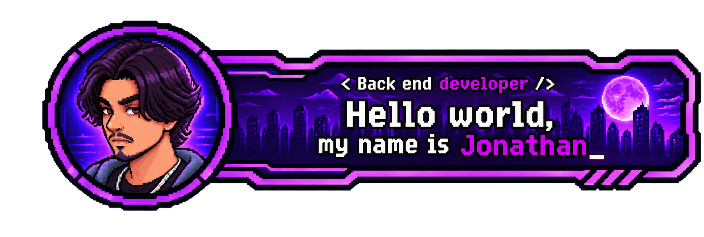

  
<!-- =============== Apresentação =============== -->

  

<!-- =============== Fim Apresentação =============== -->
  

  <samp>「 HABILIDADES E FERRAMENTAS EM DESENVOLVIMENTO 」</samp>

 

<h3 align="center">⌨️ LINGUAGENS EM ESTUDO</h3>

<table align="center">
  <tr>
    <td align="center" width="150">
      
       
      <strong>PYTHON</strong>
    </td>
    <td align="center" width="150">
      
       
      <strong>JAVA</strong>
    </td>
  </tr>
</table>

  

<h3 align="center">🛠️ FERRAMENTAS DE DESENVOLVIMENTO</h3>

<table align="center">
  <tr>
    <td align="center" width="130">
      
       
      <strong>GIT</strong>
    </td>
    <td align="center" width="130">
      
       
      <strong>GITHUB</strong>
    </td>
    <td align="center" width="130">
      
       
      <strong>VS CODE</strong>
    </td>
  </tr>
</table>

 

  <samp>━━━━━━━━━━━━━━━━ ◈ ━━━━━━━━━━━━━━━━</samp>

<!-- =============== STATUS DO JOGADOR =============== -->

<h2 align="center">📊 STATUS DO JOGADOR</h2>

  <samp>「 PROGRESSO E ATIVIDADE NO GITHUB 」</samp>

  

    

  

  <samp>「 OS PERCENTUAIS REPRESENTAM A DISTRIBUIÇÃO DE CÓDIGO NOS REPOSITÓRIOS 」</samp>

 

  <samp>🕹️ PRÓXIMO OBJETIVO: EVOLUIR A CADA PROJETO</samp>

---

## 💻 Projetos em destaque

### 🏦 Sistema Bancário
Projeto desenvolvido em Java para praticar conceitos de programação e desenvolvimento de sistemas.

🔗 [Acessar repositório](https://github.com/jonathanosmar/sistema-bancario)

### 🛒 Sistema de Supermercado
Sistema simples desenvolvido em Java para praticar lógica de programação e orientação a objetos.

🔗 [Acessar repositório](https://github.com/jonathanosmar/sistema-supermercado-java)

---

## 🎓 Formação acadêmica

- 🎓 **Análise e Desenvolvimento de Sistemas**
- 🏫 Universidade Cidade de São Paulo (UNICID)
- 💻 Foco de desenvolvimento: Back-end

---

## 🌐 Vamos nos conectar?

**Sempre aberto a aprender, colaborar e desenvolver novos projetos!**

